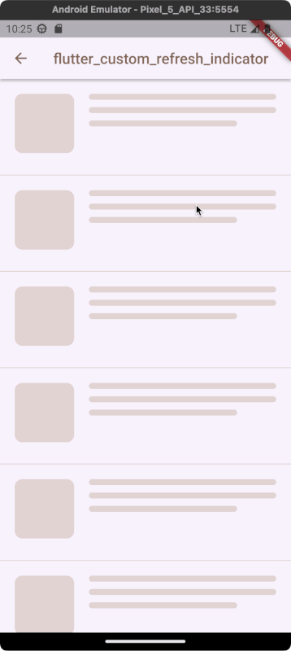

# Custom Refresh Indicator Material

The Material Design pull to refresh indicator with a customizable content, built with the [custom_refresh_indicator](https://github.com/gonuit/flutter-custom-refresh-indicator/tree/master/packages/custom_refresh_indicator) package.

In addition to the built-in _RefreshIndicator_ widget, it supports horizontal lists, triggering from both edges and a custom content.

### **[ONLINE DEMO](https://custom-refresh-indicator.klyta.it/#/example)**

## Requirements

This package uses the standalone [material_ui](https://pub.dev/packages/material_ui) and [cupertino_ui](https://pub.dev/packages/cupertino_ui) packages, so it requires Flutter 3.47 or newer. Your application should use these packages as well, see the [migration guide](https://docs.flutter.dev/release/breaking-changes/material-ui-and-cupertino-ui).

## Quick start

```dart
import 'package:custom_refresh_indicator_material/custom_refresh_indicator_material.dart';

CustomMaterialIndicator(
  onRefresh: onRefresh, // Your refresh logic
  backgroundColor: Colors.white,
  indicatorBuilder: (context, controller) {
    return Padding(
      padding: const EdgeInsets.all(6.0),
      child: CircularProgressIndicator(
        color: Colors.redAccent,
        value: controller.state.isLoading ? null : math.min(controller.value, 1.0),
      ),
    );
  },
  child: child,
)
```

The _indicatorBuilder_ argument is optional. Without it, the widget looks like the built-in _RefreshIndicator_ widget.

<div align="center">
<a href="https://custom-refresh-indicator.klyta.it/#/presentation" target="_blank">

</a>
</div>

## Programmatic control

The indicator can be shown and hidden without a pull gesture through a `GlobalKey<CustomMaterialIndicatorState>`.

```dart
final indicatorKey = GlobalKey<CustomMaterialIndicatorState>();

CustomMaterialIndicator(
  key: indicatorKey,
  onRefresh: onRefresh,
  child: child,
)

indicatorKey.currentState?.refresh();
```

The package exports the _custom_refresh_indicator_ library, so the _IndicatorController_, _IndicatorTrigger_ and other classes are available with a single import. They are described in the [custom_refresh_indicator documentation](https://github.com/gonuit/flutter-custom-refresh-indicator/tree/master/packages/custom_refresh_indicator#documentation).
